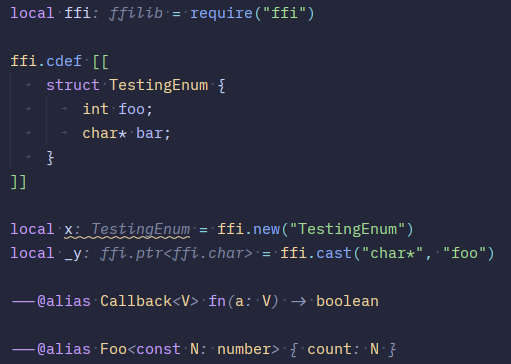

<div align="center">



# lye

**An incredibly fast and powerful language server written in and for LuaJIT**

`3.6 ms` to diagnostics, `12.6 MiB` resident, `13.5k` lines of Lua.

</div>

## What it is

`lye` is a language server for [LuaJIT](https://luajit.org): diagnostics, hover with an inferred type,
go-to-definition, semantic tokens and completion — including LuaJIT's LuaJIT 3.0 syntax backports.

It is written in the language it serves, compiles to one standalone executable, and needs no Lua, no
`lde` and no dependencies on the machine that runs it.

## Features

- **Types from the code** — inferred, evolved as a name is assigned, narrowed by the conditions above it
- **Annotations** — LuaLS's `---@` language: classes, generics, literal values, `as`, `never`, consts
- **`ffi`, properly** — `ffi.cdef` is parsed, so `ffi.new("Vec")` is a `Vec` and `v.nope` is reported
- **C types that are C types** — arrays are `ffi.array<T, N>` and indexable, pointers are `ffi.ptr<T>`, and a 64-bit scalar is `ffi.size_t` rather than a `number`
- **Callbacks are typed** — a function cast to a C callback keeps the header's parameter types
- **`require`, the lde way** — `<package>/target/?.lua`, plus `ffi`, `jit`, `string.buffer` and friends
- **The standard library** — LuaJIT's and Lua 5.1's, from eighteen definition files
- **The workspace, resolved** — on startup the whole workspace is read for what it declares, so a type named in a file nothing requires yet is already known, and what a `require` came to is kept between sessions, keyed by the file, the workspace's annotations, the package's links and the documents that were open. A session that agrees on all of those reports on an open file in a fraction of the time the first one took; `LYE_CACHE=off` turns the keeping off
- **Headless too** — the same binary checks files for CI: `lye --check src/**.lua`, handing each package to a worker process so the batch runs on the machine's cores (`LYE_WORKERS=1` checks in one)
- **Checked once, remembered** — what a check finds for a file is kept between runs, keyed by the file's own text and by everything it was read against (the batch's annotations, the package's `target/`, and the modules it requires). A tree that has not changed since the last run reports in about a tenth of a second; a file that changed is checked again only where that change can reach. Everything a run keeps lives under `./.lye` beside the project it was called in — `--cache <dir>` or `LYE_CACHE_DIR` says otherwise, `--cold` checks everything again and keeps nothing, and `LYE_CACHE=off` turns the keeping off

## Examples

```lua
local ffi = require("ffi")
ffi.cdef[[
	typedef unsigned long size_t;
	typedef struct { double x, y; } Vec;
	typedef size_t (*write_cb)(char *ptr, size_t size, void *userdata);
]]

local v = ffi.new("Vec")      -- v: Vec
v.x = 1.5                     -- ok
v.nope = 1                    -- `nope` is not a field of Vec

local size = ffi.new("size_t")
local wrong = size[1]         -- ffi.size_t cannot be indexed by a number

local write = ffi.cast("write_cb", function(ptr, size, _)
	return size * 2           -- ptr: ffi.ptr<ffi.char>, size: ffi.size_t, result checked
end)
```

```lua
local numbers = ffi.new("int[4]")     -- ffi.array<ffi.int, 4>
local first = numbers[0]              -- ffi.int

local curl = ffi.load("curl")         -- the functions this file's cdef declared
local handle = curl.curl_easy_init()
curl.curl_easy_send("not a handle", nil, 0)
-- curl.curl_easy_send expects ffi.ptr<ffi.cdata*>, got "not a handle"
```

```lua
---@param name string
---@return string?
local function greet(name) end

local who = "world"
local greeting = greet(who)           -- string?
if greeting then
	local loud = greeting:upper()     -- string
end
```

## Numbers

Measured with `editors/vscode/tests/compare.mjs` on one machine, one fixture, one harness. The
second pair is a real 2331-line file of another project rather than a fixture written to be easy:

| | lye | LuaLS | EmmyLua |
|---|---|---|---|
| keystroke → diagnostics (74-line fixture) | **3.6 ms** | 201.17 ms | 502.55 ms |
| resident | **12.6 MiB** | 34.9 MiB | 64.6 MiB |
| keystroke → diagnostics (2331-line file) | **59 ms** | 208.95 ms | 513.05 ms |
| resident | **41 MiB** | 46.3 MiB | 86.6 MiB |

Runs vary, so read the times as within about a tenth. lye's figures are medians of interleaved runs;
the other two servers' are as last measured with this same harness on this machine.

Most of the 2331-line file's residency is the JIT. One analysis of a file that size compiles
thousands of traces and LuaJIT's default cache holds a thousand, so out of the box it flushes and
refills for as long as the server runs — that is the 98 ms and 31 MiB row. Keeping the traces takes
the file to 59 ms and 41 MiB.

Semantic tokens come with their own number, since colouring a whole file at once is the request no
editor batches: on the 2331-line file lye answers 9884 tokens in 34 ms, LuaLS 4089 tokens in
95.19 ms, EmmyLua 9581 tokens in 7.20 ms.

What a process holds is the runtime and the allocator's high-water mark more than the shape of one
tree, which is why the memory work went into the collector — `collectgarbage("setpause", 150)` took
28.4 MiB to 22.3 for one line — rather than into the parser's node tables, which a full ffi arena
would cut by about a megabyte, 4% of what an editor sees.

`tools/memory.lua` reports where one document's memory goes — 0.79 MiB to lex it, 2.30 MiB to parse
it (1.20 of that the node tables, 316 bytes a node), 0.87 MiB for the definitions, 3.92 MiB for the
analysis itself — and `tools/sweep.lua` type-checks this repository with the same analyzer, which is
what keeps the numbers above honest about the code that produced them.

## Editors

| Editor | Where | Install |
|---|---|---|
| Zed | `editors/zed/` | install that directory as a dev extension |
| VS Code | `editors/vscode/` | `npm install && npm run package` |
| anything else | — | speak LSP to `lye --stdio` |

## Plugins

A workspace can add to what lye knows, in a `lye.json` that lists the plugins its files are read
with — a path for a file of the workspace's own, a name for a module the package installed with
`lde add`, and `!name` to turn off one lye ships. `lye init` writes the file:

```json
{ "plugins": ["./tools/moonscript.lua", "lye-plugin-moonscript", "!patterns"] }
```

A plugin answers one or both of two hooks, and names the files its language is written in. `lower`
turns a document into Lua — the plugin compiles what it can and says where each piece came from, lye
reads the result and reports in the original, so a fault inside a synthesized line lands on the line
the reader wrote, and something like MoonScript gets the analysis lye would give the Lua it compiles
to. `tokens` adds colours of its own, for a language or a library lye does not know: a plugin's span
wins over what lye's own walk found, so it can colour `%d` inside a literal without hiding the
literal. `lye check` reads a package through the same plugins, and its walk reaches the files they
claim — `extensions = { "moon" }` is what makes `lye check .` check a MoonScript project.

lye's own pattern, format and `ffi.cdef` colouring are plugins now, and they are the worked
examples: `packages/lye-plugin` documents the interface, the hooks a plugin answers, and what each
context carries.

## lde projects

`lde run -C <package>` resolves a module against `<package>/target/?.lua` and
`<package>/target/?/init.lua`, and `target/` holds a link per dependency. `lye` resolves `require` the
same way, against the package the document belongs to, so a module of the package itself and a
sibling package both resolve with nothing to configure.

A project that is not laid out that way can say where its modules are, in a `lye.json` at the package
or the workspace root, using patterns the way `package.path` writes them:

```json
{ "requirePaths": ["lib/?.lua", "vendor/?/init.lua"] }
```
